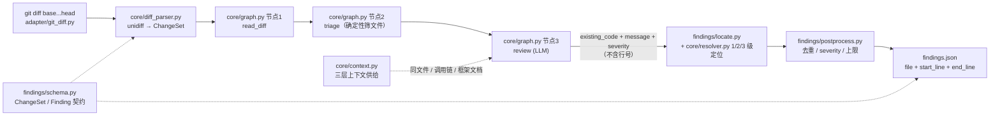

# agent-code-review

一句话：**本地 diff 进，带准确行号的 findings.json 出**——LLM 只负责说"哪段代码有问题"，行号由本地匹配算出来。

## 架构



## 为什么不直接让模型输出行号（护城河）

让模型报行号看起来省事，实际是最贵的选择：

1. **模型数不准行号。** LLM 在 diff 里数行号是常见的系统性错误——尤其 hunk 头、删除行、
   多 hunk 文件，错位往往只差一两行，但 diff review 里"差一行"就等于指错了代码，
   评审人会直接失去信任。
2. **行号错了无法自检。** 模型给的 `line 12` 没有任何可验证性；而 `existing_code`
   是一段真实代码，**能不能在文件里找到它本身就是可验证的**——找不到就丢弃，
   不会产生假阳性定位。
3. **契约更稳。** 模型只输出 `{existing_code, message, severity}`，输出越短越不容易跑偏，
   也更容易被评测集（ReviewBench）统计。
4. **行号是本地可计算的确定性工作。** 用 unidiff 拿到 hunk 的新侧行号，
   在 hunk 内做逐行匹配即可，不需要模型参与——这正是 `core/resolver.py` 的职责，
   也是后续可以逐级加强（跨 hunk → 模糊匹配）的地方。

换句话说：**模型负责语义，本地负责坐标。** 二者解耦后，定位率就成了可度量、可优化的指标，
而不是玄学。

## 定位分级

| 级别 | 策略 | 状态 |
| --- | --- | --- |
| 1 | 同一 hunk 内逐行匹配（空白归一化） | ✅ 本阶段实现 |
| 2 | 跨 hunk / 全文件匹配 | 阶段二 |
| 3 | 模糊匹配 + 相似度阈值 | 阶段二 |

定位失败的结论会被**丢弃**并记入 dropped（`--dump-dropped` 可导出），宁可不报也不错报。

已知限制（1 级）：模型若只抄了半行（例如漏掉行尾注释），整行匹配会失败并丢弃该结论。
这正是 2/3 级定位要解决的召回率问题。

## 用法

```bash
python -m venv .venv                 # 建议用虚拟环境，依赖装在哪由你来定
. .venv/bin/activate                 # Windows: .venv\Scripts\activate
pip install -r requirements.txt
export DEEPSEEK_API_KEY=...          # 或 LLM_API_KEY / OPENAI_API_KEY
python cli.py --base main --head test-branch
```

可选参数：`--repo` `--out` `--model` `--base-url` `--max-files` `--locate-level` `--dump-dropped`。

LLM 走 OpenAI 兼容接口，默认 `https://api.deepseek.com/v1` + `deepseek-chat`。

> 依赖一律来自 `pip install -r requirements.txt` 装到的环境；代码里没有任何 `sys.path`
> 注入，也不读仓库内的依赖目录（确保 clone 后行为一致）。

## 测试

```bash
python -m unittest discover -s tests -t .
```

覆盖：契约 JSON 往返、diff 解析行号、1 级定位（含失败与越级）、locate 排序/丢弃、
确定性指标（匹配/容差/一对一贪心/汇总）、golden 与预测加载、
以及临时 git 仓库上的端到端链路（用假 LLM 客户端，不联网）。

## 评估接入（第二阶段）

数据集用 GitHub 官方的 [ReviewBench](https://github.com/review-bench/ReviewBench)：

```bash
git -c http.sslBackend=openssl clone --depth 1 https://github.com/review-bench/ReviewBench D:\reviewbench-data
```

- `corpus/test/` —— 25 题测试集（`test.json` 元数据 + `findings.json` golden），`golden/` 是全量 219 题。
- 跑一题：先在镜像仓库 checkout 上生成预测，再打分。

```bash
python cli.py --base <base-sha> --head <head-sha> --repo <checkout> --out findings.json
python -m eval.run_eval --corpus D:\reviewbench-data\corpus\test \
    --pred findings.json --task <owner>_<repo>_<pr>-<head8> --out report.json
```

> **指标口径**：官方 matcher（`scripts/eval/matcher.ts`）用 LLM 判断两条 findings 是否
> 「同一个问题」。`eval/metrics.py` 是**确定性代理**：同文件 + 行区间重叠（可给容差）即算命中。
> 它便宜、可复现，适合做回归和相对比较；对官方口径的绝对值没有可比性，别拿它对外报数。
> 冒烟自检：拿 golden 当预测输入，本实现给出 P=R=F1=1.000。

## 降误报（第三阶段）

两道防线，都不碰 resolver：

1. **收紧审查范围（prompt）**：只报 production 代码的安全 / 正确性 / 可靠性问题；显式排除
   样式 nitpick、CSS 变量、测试文件、纯文档；severity 只允许 high/medium；每个文件最多 3 条、
   整次最多 8 条。
2. **后处理（`findings/postprocess.py`）**：同文件 + 行区间重叠去重 → 丢 low/info →
   整次最多 `--max-findings`（默认 10）条，超出按严重级截断。只做减法，不改行号。

全量 25 题前后对比（同 23 题口径）：P 0.308→0.444，R 0.346→0.178，F1 0.326→0.254，
FP 245→70。误报大幅下降，但"少报"把真问题也压掉了，recall 腰斩——下一步的瓶颈在召回而非精度。

## 分诊与放松抑制（第四阶段）

- **分诊节点**（`core/triage.py`，确定性、不调 LLM）：`read_diff → triage → review`，路径规则跳过
  测试 / 样式 / 文档 / 锁与依赖清单 / 生成物，只对剩下的文件花模型调用。`changesets` 本身不动，
  定位仍在全部变更文件上做，避免"跳过的文件让已有 finding 定位失败"。
- **放松抑制**：severity 只过滤 `low`（prompt 允许标 low），删掉"拿不准别报"，单 PR 上限 10 → 20。

全量（23 题同口径）：P 0.308→0.373，R 0.346→0.187，F1 0.326→0.249，FP 245→99，TP 109→59。
两个反直觉结论：① 分诊按"只看 production"筛，但本 benchmark 有 **18% 的 golden 就在被跳过的
文件里**（ForgeMap 15 条里 14 条是 CSS），分诊的召回损失抵掉了放松带来的收益；
② "prompt 允许标 low + 后处理丢弃 low"自相矛盾，模型把真问题标成 low 后直接被丢掉。

## 分层评估与三级定位（第五阶段）

- **分层评估**：`eval/run_eval.py` 按分诊口径把 golden 与预测各分两层（production / skipped），
  分层各算 P/R/F1 并单独打印，避免"总分被大量注定不审的文件稀释"。
- **定位分级**（`core/resolver.py`）：1 级 hunk 内逐行匹配 → 2 级全文滑动窗口（规范化 CRLF/行尾空白）
  → 3 级 LLM 重定位（喂带行号的文件内容，拿回行号后**本地校验**该区间确实包含该片段，
  校验不过就丢弃）。`cli.py` 打印每级命中数，`--locate-level` 控制最高等级。

全量 25 题（23 题同口径）实测：1 级命中 **98.9%**，2 级 **0%**，3 级 **0.4%**，失败 0.7%。
也就是说模型引用的代码几乎总在 hunk 里，2/3 级目前是保险而不是增量。分层结果：production 层
F1 **0.356**，skipped 层 0（分诊后这些文件根本不送审）。

## 模型对照实验（第六阶段）

同一套 prompt、同一套流程，只换模型（`LLM_MODEL`）跑全量 23 题（两次都能跑通的那批）：

| 模型 | TOTAL F1 | production 层 P / R / F1 | production tp/fp/fn | 单题耗时中位 |
| --- | --- | --- | --- | --- |
| `deepseek-chat` | 0.312 | 0.455 / 0.293 / **0.356** | 75 / 90 / 181 | 22 s |
| `deepseek-reasoner` | 0.215 | 0.385 / 0.184 / **0.249** | 47 / 75 / 209 | 200 s |

结论：换"更强的推理模型"**没有**改善，反而更差（production F1 −0.107），而且慢约 9 倍
（最长一题 52 分钟，超过 ReviewBench 官方每 PR 15 分钟的限制）。

production 层 181 条漏报的分布：correctness 72、reliability 29、maintainability 26、
security 14、testing 12、api-architecture 11、performance 9、documentation 7、accessibility 1。
抽样看，漏报集中在**需要框架/库 API 语义**的正确性问题（reatom v2 API、MapLibre 事件时序、
ECMAScript flag 细节），不是"模型不够聪明"能一笔带过的，更像是上下文不足。

## 上下文供给（第七阶段，核心机制）

**瓶颈不在模型档位，在模型看到了什么。** 这一阶段把喂给模型的输入从"只有 diff"扩成三层，
全部是本地确定性计算（不额外调 LLM），开关是环境变量 `ACR_CONTEXT_LAYERS`（默认 `1,2,3`，
置 `0` 即等价于改前的纯 diff 输入）。

| 层 | 做什么 | 上限 |
| --- | --- | --- |
| 1 同文件 | 被改文件的**非 diff 部分**：import 段、类型/类定义、被改函数之外的其它函数，按 import > 类型 > 离改动最近排序 | 100 行 |
| 2 调用链 | 被改函数的**调用方**与**被调用方**片段各取前后 20 行；Python 走 `ast`，其它语言走正则 + 缩进/花括号配平，支持跨文件 import 解析 | 24000 字符（≈8k token） |
| 3 框架文档 | 从 import 与 API 指纹检测框架/库，检索内置文档片段 top-3（reatom / MapLibre / React / FastAPI / Express / pytest-mock / node-postgres / Go context / .NET / GitHub Actions / Ruby gemspec 等） | 3 条 |

实现在 `core/context.py`，由 `core/graph.py` 的深审节点逐文件拼装后注入 user prompt；
模板不含 `{context}` 占位符时退回旧行为。任何一层算不出来都只是少一段文本，
检测不到框架时第三层直接跳过——**不为上下文供给引入新的失败模式**。

### 换模型 vs 补上下文

同一批题、同一个模型做 A/B（`ACR_CONTEXT_LAYERS=0` vs `1,2,3`）：

| 口径 | production P | R | F1 |
| --- | --- | --- | --- |
| `glm-4.5-air`，纯 diff | 0.364 | 0.080 | 0.131 |
| `glm-4.5-air`，三层上下文 | **0.438** | **0.140** | **0.212** |
| `deepseek-chat`，纯 diff（同题集参考） | 0.353 | 0.120 | 0.179 |

结论：**补上下文比换更强的模型划算**。`glm-4.5-air` 加上下文后（0.212）反超
`deepseek-chat` 纯 diff（0.179）；而第六阶段的换模型实验里，更强的 deepseek-reasoner
反而比 deepseek-chat 低 0.107。也就是说前面那个"换模型没用"的现象，
本质是**上下文不足**，不是模型不够聪明。

代价是输入变长：同题集 prompt token 60k → 145k（×2.4，单文件最多约 5.8k），
耗时中位 148s → 400s（×2.7，其中含有上游拥塞的放大）。

> **口径说明**：这一轮用的第三方 key 只开放 `glm-4.5-air`，且 8 题里有 3 题被上游
> 超时/限流打断，所以上表是**同一模型、同一 5 题子集**的可比结果，绝对值**不能**和
> 前面全量 23 题的 `deepseek-chat` 基线（production F1 0.356）直接对比。
> 子集取的是 production 层 F1 最低的 7 题，另加 1 题框架知识样本（MapLibre/reatom）。

### 依赖：fastembed 是可选的

第三层用 **fastembed**（默认 `BAAI/bge-small-en-v1.5`）对内置文档片段做向量检索。
它是**可选依赖**：没装、模型下载不下来、或者嵌入失败时，`core/context.py` 会自动降级成
IDF 加权的词法检索，第三层照常工作，**主流程完全不受影响**（每进程只尝试一次，
不会反复卡在模型下载上）。想省掉这份依赖，把 `fastembed` 从 `requirements.txt` 删掉即可。

## 降误报：置信度闸 + 语义聚类去重（第八阶段）

两条新防线都只做减法，不碰 resolver：`core/filter.py` 管语义层（模型自评的把握、
换着说法重复报的同一处问题），`findings/postprocess.py` 继续管结构层（行区间重叠 /
severity / 上限）。`confidence` 进入契约（`findings/schema.py`），并随 `needs_review` 一起
写进 `findings.json`。

- **置信度闸**（定位前，`filter_by_confidence`）：`>= 0.8` 保留；`0.5 ~ 0.8` 保留并标
  `needs_review`；`< 0.5` 丢弃。模型没给或给不出来时按 0.5（待复核）处理。
- **语义聚类去重**（定位后，`cluster_findings`）：同文件 + message 字符 bigram Dice `>= 0.6`
  视为同一组（并查集传递闭包），每组只留"最具体"的一条——行区间最窄（行号最精确）→ 
  message 最长（描述最详细）→ 置信度最高 → severity 最高。
- **prompt 侧**：system prompt 增加 `confidence` 字段，并把分档锚点对齐后处理的 0.8 / 0.5
  两条线，要求模型给出"说不出的失败路径就压到 0.5 以下"。

5 题子集（cmik_apilix_12 / PaulStSmith_figlet_32 / superhighfives_pika_200 /
mheuss_chronicle_14 / wirechat_wirechat_183，86 条 golden）三阶段实测：

| 阶段 | findings | tp/fp/fn | P | R | F1 |
| --- | --- | --- | --- | --- | --- |
| 改前（老 prompt + 老后处理） | 68 | 21 / 47 / 65 | 0.309 | 0.244 | 0.273 |
| + 置信度闸 | 68 | 27 / 41 / 59 | **0.397** | **0.314** | **0.351** |
| + 语义聚类去重 | 68 | 27 / 41 / 59 | 0.397 | 0.314 | 0.351 |

两条必须记住的结论：

1. **置信度是真信号，但模型把分辨率浪费在 0.5~0.8 档。** 定位后分档 precision：
   `>= 0.8` 2 条 / P=1.000，`0.5~0.8` 115 条 / P=0.339，`< 0.5` 37 条 / P=0.162。
   规范要求"0.5~0.8 保留"，而这一档占了全部结论的 75%，precision 上限就被它按在 0.4 附近。
   阈值扫描：保留线抬到 0.6 → P 0.512 / R 0.244；0.75 → P 0.647 / R 0.128；
   0.8 → P 1.000 / R 0.012。**要摸到 P 0.65 就得把保留线抬到 0.75 以上，召回同时腰斩。**
2. **本数据集上语义去重是空操作。** 同文件 message 两两 bigram Dice 最大只有 0.458
   （< 0.6 阈值），没有任何一对达到"同一组"；老的行区间重叠去重本身也只有 ~5% 合并率。
   也就是说模型并不换着说法重复报同一处——去重这套代码是保险，不是增量。

## 两个确定性过滤：类型白名单 + 文件级评分（第九阶段）

两条闸都是确定性的（不额外调 LLM），实现在 `core/filter.py`，开关落在 `core/graph.py` /
`cli.py`：

1. **类型白名单**（`filter_by_type`）：必报 SQL注入 / 路径穿越 / XSS / 空指针 / 越界 / 资源泄漏，
   不报命名 / 注释 / CSS / 文档 / 格式 / 测试 / 重构。两种口径：
   `blacklist`（默认，只丢"不报"那一栏）与 `strict`（六类之外全丢）。
   prompt 侧同步把"只报这三类"换成六类白名单（**prompt 改动本轮未实测**，见下）。
2. **文件级评分**（`filter_files_by_score` / `score_changeset`）：production 逻辑 +0.4、
   改动 > 5 行 +0.3、敏感操作（DB / 文件 / 网络 / 权限）+0.3，`< 0.5` 的文件**在模型调用之前**
   整份跳过（`--file-score-threshold` / `ACR_FILE_SCORE_THRESHOLD`），这是省 token 的那道闸。
   这 5 题里它跳掉 18/69 个待深审文件。

### 验证口径（重要）

本机**没有可用的 API key**（`~/.dsh` 里那把 DeepSeek key 实测 401），所以这一轮是
**离线确定性重放**：用 `.tmp/new_raw/` 里缓存好的模型原始结论（5 题子集，
`cmik_apilix_12 / PaulStSmith_figlet_32 / superhighfives_pika_200 / mheuss_chronicle_14 /
wirechat_wirechat_183`，86 条 golden）重跑定位 → 各道闸 → 后处理。
重放先复现了 README 第八阶段基线（68 条，tp/fp/fn = 27/41/59，P 0.397），口径可比。

**未验证的部分**：① prompt 里新增的类型白名单（没有重跑模型，重放吃的是旧 prompt 的输出）；
② 文件评分"省掉多少次模型调用"只报了受影响的结论条数，没报 token/耗时。

| 阶段 | findings | tp/fp/fn | P | R | F1 |
| --- | --- | --- | --- | --- | --- |
| A 当前基线 | 68 | 27 / 41 / 59 | 0.397 | 0.314 | 0.351 |
| B + 类型白名单（blacklist） | 53 | 21 / 32 / 65 | 0.396 | 0.244 | 0.302 |
| B' + 类型白名单（strict，六类之外全丢） | 13 | 6 / 7 / 80 | 0.462 | 0.070 | 0.121 |
| C + 文件级评分（<0.5 跳过） | 50 | 19 / 31 / 67 | 0.380 | 0.221 | 0.279 |

结论（三条，都是反直觉的）：

1. **没摸到 P ≥ 0.55。** 最好的一档是 0.462，而且召回已经掉到 0.070；想把 P 抬到 0.55
   只剩"只留 high"这种极端档（P 0.556 / R 0.058），等于不报。
2. **类型白名单在结论层打不中误报。** 丢掉的 39 条里 tp/fp 几乎等比（21/32 → 0.396），
   也就是说"命名/注释/格式/文档/重构"这一栏里本来就有真问题（本数据集里 `docs` 类
   P=1.000，`naming/refactor` 才是 0.000）。逐类拆开看，tp 与 fp 的 message 都在描述
   "看起来成立的正确性问题"（数据丢失 / 静默失败 / 竞态 / 缺超时），差别在**证据是否落地**，
   不在类别上——确定性关键词过滤拿不到这个信号。
3. **文件级评分在这 5 题上是精度负收益（−0.042），不是幻觉增益。** 它的价值是"少送文件、
   少花 token"：5 题共 69 个待深审文件里跳过 18 个（约 26% 的模型调用），代价是被跳过的文件
   上也有结论被一起丢掉（原始结论 12 条，定位后 68 → 62 / 53 → 50 条）。拿它做精度闸不成立。

规则网格（同一批缓存结论上扫 `type × severity × file-score`，横轴口径见上）：

| type | sev | file | fnd | tp | fp | fn | P | R | F1 |
| --- | --- | --- | --- | --- | --- | --- | --- | --- | --- |
| none | all | all | 68 | 27 | 41 | 59 | 0.397 | 0.314 | 0.351 |
| none | all | score>=0.5 | 62 | 22 | 40 | 64 | 0.355 | 0.256 | 0.297 |
| none | high | all | 9 | 5 | 4 | 81 | 0.556 | 0.058 | 0.105 |
| blacklist | all | all | 53 | 21 | 32 | 65 | 0.396 | 0.244 | 0.302 |
| blacklist | all | score>=0.5 | 50 | 19 | 31 | 67 | 0.380 | 0.221 | 0.279 |
| blacklist | high | all | 8 | 5 | 3 | 81 | 0.625 | 0.058 | 0.106 |
| strict6 | all | all | 13 | 6 | 7 | 80 | 0.462 | 0.070 | 0.121 |
| strict6 | high | all | 4 | 3 | 1 | 83 | 0.750 | 0.035 | 0.067 |

**下一步的杠杆不在"过滤"，在"证据落地"**：既然 tp/fp 的差别是"说不说得出一条确定的失败路径"，
那就该让模型为每条结论显式给出触发路径（哪一行、什么输入、什么后果），再按"路径是否可验证"
过滤——而不是继续按类别和文件特征做减法。

## MVP 的边界（本阶段刻意不做）

- **只支持本地 diff**：`adapter/github_pr.py` 只是占位，不接 GitHub API、不接 PR 评论。
- **不做多智能体**：链路是 `read_diff → triage → review` 三个节点，不拆角色、不做自检循环。
- **定位仍是"保险"不是"增量"**：1 级命中 98.9%，2/3 级（全文滑窗 / LLM 重定位）只有 0% / 0.4%。
- **评估只用确定性代理**，尚未接官方 LLM judge；也不做官方要求的容器化提交（AGENT_CONTRACT）。
- **不做修复建议、不做历史学习**（去重见第八阶段）。
