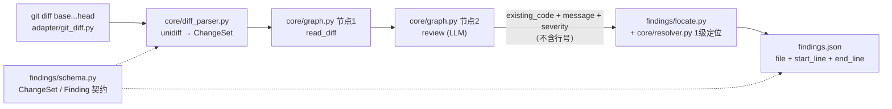

# agent-code-review

一句话：**本地 diff 进，带准确行号的 findings.json 出**——LLM 只负责说"哪段代码有问题"，行号由本地匹配算出来。

## 架构



## 为什么不直接让模型输出行号（护城河）

让模型报行号看起来省事，实际是最贵的选择：

1. **模型数不准行号。** LLM 在 diff 里数行号是常见的系统性错误——尤其 hunk 头、删除行、
   多 hunk 文件，错位往往只差一两行，但 diff review 里"差一行"就等于指错了代码，
   评审人会直接失去信任。
2. **行号错了无法自检。** 模型给的 `line 12` 没有任何可验证性；而 `existing_code`
   是一段真实代码，**能不能在文件里找到它本身就是可验证的**——找不到就丢弃，
   不会产生假阳性定位。
3. **契约更稳。** 模型只输出 `{existing_code, message, severity}`，输出越短越不容易跑偏，
   也更容易被评测集（ReviewBench）统计。
4. **行号是本地可计算的确定性工作。** 用 unidiff 拿到 hunk 的新侧行号，
   在 hunk 内做逐行匹配即可，不需要模型参与——这正是 `core/resolver.py` 的职责，
   也是后续可以逐级加强（跨 hunk → 模糊匹配）的地方。

换句话说：**模型负责语义，本地负责坐标。** 二者解耦后，定位率就成了可度量、可优化的指标，
而不是玄学。

## 定位分级

| 级别 | 策略 | 状态 |
| --- | --- | --- |
| 1 | 同一 hunk 内逐行匹配（空白归一化） | ✅ 本阶段实现 |
| 2 | 跨 hunk / 全文件匹配 | 阶段二 |
| 3 | 模糊匹配 + 相似度阈值 | 阶段二 |

定位失败的结论会被**丢弃**并记入 dropped（`--dump-dropped` 可导出），宁可不报也不错报。

已知限制（1 级）：模型若只抄了半行（例如漏掉行尾注释），整行匹配会失败并丢弃该结论。
这正是 2/3 级定位要解决的召回率问题。

## 用法

```bash
python -m venv .venv                 # 建议用虚拟环境，依赖装在哪由你来定
. .venv/bin/activate                 # Windows: .venv\Scripts\activate
pip install -r requirements.txt
export DEEPSEEK_API_KEY=...          # 或 LLM_API_KEY / OPENAI_API_KEY
python cli.py --base main --head test-branch
```

可选参数：`--repo` `--out` `--model` `--base-url` `--max-files` `--locate-level` `--dump-dropped`。

LLM 走 OpenAI 兼容接口，默认 `https://api.deepseek.com/v1` + `deepseek-chat`。

> 依赖一律来自 `pip install -r requirements.txt` 装到的环境；代码里没有任何 `sys.path`
> 注入，也不读仓库内的依赖目录（确保 clone 后行为一致）。

## 测试

```bash
python -m unittest discover -s tests -t .
```

覆盖：契约 JSON 往返、diff 解析行号、1 级定位（含失败与越级）、locate 排序/丢弃、
确定性指标（匹配/容差/一对一贪心/汇总）、golden 与预测加载、
以及临时 git 仓库上的端到端链路（用假 LLM 客户端，不联网）。

## 评估接入（第二阶段）

数据集用 GitHub 官方的 [ReviewBench](https://github.com/review-bench/ReviewBench)：

```bash
git -c http.sslBackend=openssl clone --depth 1 https://github.com/review-bench/ReviewBench D:\reviewbench-data
```

- `corpus/test/` —— 25 题测试集（`test.json` 元数据 + `findings.json` golden），`golden/` 是全量 219 题。
- 跑一题：先在镜像仓库 checkout 上生成预测，再打分。

```bash
python cli.py --base <base-sha> --head <head-sha> --repo <checkout> --out findings.json
python -m eval.run_eval --corpus D:\reviewbench-data\corpus\test \
    --pred findings.json --task <owner>_<repo>_<pr>-<head8> --out report.json
```

> **指标口径**：官方 matcher（`scripts/eval/matcher.ts`）用 LLM 判断两条 findings 是否
> 「同一个问题」。`eval/metrics.py` 是**确定性代理**：同文件 + 行区间重叠（可给容差）即算命中。
> 它便宜、可复现，适合做回归和相对比较；对官方口径的绝对值没有可比性，别拿它对外报数。
> 冒烟自检：拿 golden 当预测输入，本实现给出 P=R=F1=1.000。

## 降误报（第三阶段）

两道防线，都不碰 resolver：

1. **收紧审查范围（prompt）**：只报 production 代码的安全 / 正确性 / 可靠性问题；显式排除
   样式 nitpick、CSS 变量、测试文件、纯文档；severity 只允许 high/medium；每个文件最多 3 条、
   整次最多 8 条。
2. **后处理（`findings/postprocess.py`）**：同文件 + 行区间重叠去重 → 丢 low/info →
   整次最多 `--max-findings`（默认 10）条，超出按严重级截断。只做减法，不改行号。

全量 25 题前后对比（同 23 题口径）：P 0.308→0.444，R 0.346→0.178，F1 0.326→0.254，
FP 245→70。误报大幅下降，但"少报"把真问题也压掉了，recall 腰斩——下一步的瓶颈在召回而非精度。

## MVP 的边界（本阶段刻意不做）

- **只支持本地 diff**：`adapter/github_pr.py` 只是占位，不接 GitHub API、不接 PR 评论。
- **只有 2 个节点**：`read_diff → review`。不做多智能体、不做角色拆分、不做自检循环。
- **只实现 1 级定位**：跨 hunk / 模糊匹配留到后面。
- **评估只用确定性代理**，尚未接官方 LLM judge；也不做官方要求的容器化提交（AGENT_CONTRACT）。
- **不做去重、不做修复建议、不做历史学习**。
